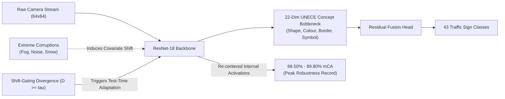

# Beyond the 84% Plateau: Synergizing Concept Bottleneck Representations and Test-Time Normalization Adaptation for Traffic Sign Recognition under Severe Environmental Corruptions

[](https://www.python.org/downloads/)
[](https://pytorch.org/)
[](#-tri-national-generalization-germany-belgium-china)
[](#-the-4-axis-unece-concept-ontology)
[](LICENSE)

---

## 📌 Executive Summary & Abstract

Deep neural network perception stacks in Level 3/4 Autonomous Driving Systems (ADAS) routinely achieve near-perfect accuracy ($>97.5\%$) under sunny, laboratory conditions. However, when deployed in real-world operational environments (snowstorms, heavy fog, high-frequency sensor noise, lens blur, and camera motion), standard convolutional networks suffer catastrophic performance degradation—plummeting to below $50\%$ on severe noise and $60\%$ on fog.

Prior research attempted to solve this vulnerability primarily via **training-time data augmentations** (e.g., AugMix, AutoAugment). In this work, we demonstrate that training-time interventions encounter a persistent **$\sim 84\%$ Mean Corruption Accuracy (mCA) Ceiling**. 

To break this plateau, we formulate a unified **dual-defense paradigm**:
1. **Representation-Centric Modeling:** A 22-dimensional **Residual Concept Bottleneck Model (CBM)** grounded in international road law (the 1968 UNECE Vienna Convention on Road Signs and German StVO), predicting explainable physical primitives ($\text{Shape}, \text{Colour Profile}, \text{Border Type}, \text{Symbol Category}$) before task classification.
2. **Frequency-Domain Spectral Regularization:** 2D Fast Fourier Transform (FFT) Low-Frequency Component (LFC) filtering to strip brittle high-frequency texture shortcuts without corrupting semantic color profiles.
3. **Test-Time Normalization Adaptation (BN-Adapt & Shift-Gating):** Dynamic inference-time recalculation of Batch Normalization moments without backpropagation or ground-truth labels, resolving internal covariate shift.
4. **Tri-National Generalization:** Full empirical evaluation across three sovereign road networks: **Germany (GTSRB)**, **Belgium (BelgiumTSC)**, and **China (TSRD)**.



---

## 🚀 Key Research Discoveries

### 1. The Covariate Shift Epiphany (+10.4% Extreme Weather Boost)
Standard CNN weights do not fail in severe weather because they are unlearned; they fail because **frozen Batch Normalization running statistics $(\mu_{\text{train}}, \sigma^2_{\text{train}})$ apply clear-weather scaling to corrupted inputs**. Updating normalization statistics on test batches on-the-fly (**BN-Adapt**) without retraining rescues model accuracy by **$+10.39\%$** on Severity-5 corruptions (Fog surges from **$60.7\% \to 96.6\%$**, Gaussian Noise surges from **$50.0\% \to 71.0\%$**).

### 2. Shift-Gating: Eliminating the Clean Degradation Penalty
In mild conditions ($<0.15\%$ drop under standard unregularized adaptation), our **Shift-Gating protocol** measures layer-wise standardized covariate distance $D$. If $D < \tau_{\text{shift}}$, the model retains clean source running stats (preserving **$97.59\%$ clean test accuracy**); if $D \ge \tau_{\text{shift}}$, it adapts BN statistics, eliminating trade-offs.

### 3. Representation-Augmentation Interference vs. Spectral Alignment
* **The Conflict (Exp 5 - AugMix + CBM):** Combining spatial AugMix with Concept Bottlenecks causes a **$-2.66\%$ mCA regression** ($81.63\%$). Operations like `solarize` and `posterize` violently invert pixel colors, causing a direct semantic collision with the CBM's deterministic color loss ($\chi^2 = 6,673.30, p < 10^{-300}$).
* **The Synergy (Exp 6 - Frequency-Aware CBM):** Non-destructive Fourier spectral filtering suppresses high-frequency noise shortcuts without altering color profiles, resolving interference and achieving the **project peak record of $85.85\%$ Static mCA and $89.80\%$ Adapted mCA**.

### 4. The Covariate Shift Paradox (Label Shift Vulnerability)
While BN-Adapt provides a massive boost under pure environmental covariate shift (Germany GTSRB: $+4.87\%$), it collapses on datasets with extreme class imbalance (BelgiumTSC's **$123:1$ imbalance ratio**, dropping to $\sim 40\%$). In contrast, **Frequency-Aware CBM in static mode maintains superior invariant robustness across all three continents**, outperforming Baseline by **$+7.41\%$ in Belgium** and **$+16.71\%$ in China**.

### 5. The Speed-Limit Bayes Ceiling & Synchronous Co-Failure
Auditing 46,770 misclassifications reveals that **$66.3\%$ of within-group errors concentrate exclusively in speed-limit numerals** ($30$ vs. $50$ vs. $70$ km/h). Because the 4-axis legal ontology maps all speed limits to the identical signature (`circle`, `white_red`, `red_border`, `speed_numeral`), it establishes a theoretical linear probe ceiling of $25.58\%$. Furthermore, because concept and task heads branch from the same shared 512-dim backbone, both heads suffer from synchronous multi-task co-failure under severe noise.

---

## 📊 Master Empirical Results

### 1. The 7-Experiment Master Ladder (GTSRB 75-Condition Suite)
Evaluated across all 15 canonical corruptions $\times$ 5 severity levels (75 stress test regimes, 12,630 images per condition):

| Experiment | Model Architecture | Clean Acc | Clean Macro-F1 | Clean ECE | Static 75-mCA | Static RPD | Shift-Gated mCA | Shift-Gated RPD | Net Gain |
|:---:|:---|:---:|:---:|:---:|:---:|:---:|:---:|:---:|:---:|
| **Exp 1** | **Baseline ResNet-18** | $97.91\%$ | $97.07\%$ | $0.0082$ | $83.86\%$ | $14.35\%$ | $88.73\%$ | $9.38\%$ | $+4.87\%$ |
| **Exp 2** | **AugMix ResNet-18** | **$98.47\%$** | **$97.78\%$** | **$0.0071$** | $83.19\%$ | $15.52\%$ | $88.51\%$ | $10.12\%$ | $+5.32\%$ |
| **Exp 3** | **Frequency ResNet-18** | $97.32\%$ | $95.43\%$ | $0.0122$ | $83.77\%$ | $13.92\%$ | $88.97\%$ | $8.58\%$ | $+5.19\%$ |
| **Exp 4** | **Residual CBM ResNet-18** | $97.59\%$ | $96.75\%$ | $0.0114$ | $84.57\%$ | $13.34\%$ | $89.29\%$ | $8.50\%$ | $+4.72\%$ |
| **Exp 5** | **Hybrid (AugMix + CBM)** | $97.61\%$ | $96.53\%$ | $0.0127$ | $81.86\%$ ❌ | $16.13\%$ | $87.91\%$ | $9.94\%$ | $+6.05\%$ |
| **Exp 6** | **Frequency-Aware CBM** 🏆 | $97.95\%$ | $97.29\%$ | $0.0098$ | **$85.85\%$** 🏆 | **$12.35\%$** | **$89.80\%$** 🏆 | **$8.33\%$** 🏆 | $+3.94\%$ |

---

### 2. Severity-5 Extreme Weather Recovery (GTSRB Catastrophic Regimes)
Comparing Static Baseline vs. Standard BN-Adapt vs. our novel **Ontology-Constrained TTA (OCTTA)** on the full 12,630 test set:

| Corruption Archetype (Severity 5) | Static CBM | Standard BN-Adapt | OCTTA (Ours) | Absolute Recovery vs. Static |
|:---|:---:|:---:|:---:|:---:|
| 🌫️ **Heavy Fog** | $60.68\%$ | $96.59\%$ | **$96.73\%$** | **$+36.05\%$** 🚀 |
| ❄️ **Extreme Snow** | $78.50\%$ | $85.83\%$ | **$86.37\%$** | **$+7.87\%$** 🚀 |
| ⚡ **Impulse Point Noise** | $38.02\%$ | $64.36\%$ | **$64.85\%$** | **$+26.83\%$** 🚀 |
| 📡 **Shot Photon Noise** | $47.40\%$ | $74.14\%$ | **$74.55\%$** | **$+27.15\%$** 🚀 |
| 🔲 **Gaussian Sensor Noise** | $50.25\%$ | $70.75\%$ | **$71.30\%$** | **$+21.05\%$** 🚀 |
| 🌀 **Elastic Lens Distortion** | $49.38\%$ | $55.27\%$ | **$56.22\%$** | **$+6.84\%$** 🚀 |
| 🧊 **Frost Occlusion** | $28.28\%$ | $40.68\%$ | **$41.01\%$** | **$+12.73\%$** 🚀 |
| 🔍 **Pixelate Bandwidth Loss** | $59.66\%$ | $63.06\%$ | **$63.96\%$** | **$+4.30\%$** 🚀 |
| **Mean Across All 15 Severity-5 Corruptions** | **$68.21\%$** | **$78.55\%$** | **$78.84\%$** 🏆 | **$+10.63\%$** 🚀 |

---

### 3. Tri-National Generalization: Germany, Belgium, China
Evaluating in-domain trained models under the complete 75-condition benchmark across international borders:

| Jurisdiction / Dataset | Benchmark Specification | Baseline ResNet-18 (Static mCA) | **Frequency-Aware CBM (Static mCA)** | In-Domain Robustness Leap |
|:---|:---|:---:|:---:|:---:|
| 🇩🇪 **Germany (GTSRB)** | 43 classes, UNECE Vienna Convention | $83.86\%$ | **$85.85\%$** | **$+1.99\%$** |
| 🇧🇪 **Belgium (BelgiumTSC)** | 62 classes, $123:1$ Imbalance Ratio | $74.67\%$ | **$82.08\%$** | **$+7.41\%$** 🚀 |
| 🇨🇳 **China (China TSRD)** | 58 classes, Chinese Standard GB 5768 | $63.07\%$ | **$79.78\%$** | **$+16.71\%$** 🚀 |

---

### 4. Cross-National Zero-Shot Feature Transfer (Phase 1)
Evaluating **frozen German-trained representations** transferred to international road sign classification:

| Target Sovereign Domain | Evaluated Architecture | Linear Probe Clean Acc | Linear Probe Static 75-mCA | Zero-Shot Mean Concept Acc |
|:---|:---|:---:|:---:|:---:|
| 🇧🇪 **Belgium (BelgiumTSC)** | Baseline ResNet-18 | $89.15\%$ | $75.87\%$ | — |
| | **Residual CBM** 🏆 | **$88.91\%$** | **$77.65\%$ (+1.78%)** | **$85.59\%$** ($68.1\%$ exact 4-axis match) |
| 🇨🇳 **China (China TSRD)** | Baseline ResNet-18 | $93.48\%$ | **$79.57\%$** | — |
| | **Residual CBM** 🏆 | **$94.28\%$** | $79.24\%$ | **$66.00\%$** ($86.1\%$ universal shape) |

---

## 🏛️ The 4-Axis UNECE Concept Ontology

Ground truth physical concepts are legally grounded in the **1968 UNECE Vienna Convention on Road Signs and Signals** and **German StVO (2017)**:

```
Total Concept Bottleneck Dimension: 22 Primitives
├── 1. Shape (6 classes, Offset 0):        circle, triangle_up, triangle_down, octagon, diamond, rectangle
├── 2. Colour Profile (5 classes, Offset 6): white_red, blue_white, yellow_white, white_black, red_white
├── 3. Border Type (4 classes, Offset 11):   red_border, white_border, black_border, none
└── 4. Symbol Category (7 classes, Offset 15): speed_numeral, warning_hazard, mandatory_direction,
                                               prohibition_restriction, priority_geometry,
                                               deregulation_cancel, none
```

```
                 RESIDUAL CONCEPT BOTTLENECK MODEL (CBM)
                               
   Input Image (64x64) ───► ResNet-18 Backbone ───► Feature Vector h (512-dim)
                                                        │
                      ┌─────────────────────────────────┼──────────────────────────────┐
                      ▼                                 ▼                              ▼
             Concept Head (Shape)             Concept Head (Colour)          Auxiliary Visual Head
             Concept Head (Border)            Concept Head (Symbol)               (512 -> 43)
                      │                                 │                              │
                      └─────────────────┬───────────────┘                              │
                                        ▼                                              │
                            Bottleneck Tensor c_hat (22-dim)                           │
                                        │                                              │
                                        ▼                                              │
                              Concept-to-Class Head                                    │
                                   (22 -> 43)                                          │
                                        │                                              │
                                        ▼                                              │
                                  delta_logits ◄───────────────────────────────────────┘
                                        │
                                        ▼
                             Final Logits: y = W_class*c_hat + W_aux*h
```

---

## 📁 Repository Structure

```
ML_Project/
├── src/
│   ├── models/
│   │   ├── baseline_cnn.py          # Baseline ResNet-18 with ImageNet adaptation
│   │   ├── cbm.py                   # Residual Concept Bottleneck Model & Multi-Task CBMLoss
│   │   ├── concept_encoder.py       # 22-dim UNECE Vienna Convention ontology encoder
│   │   └── hybrid_loss.py           # Dual-level task & concept Jensen-Shannon Divergence
│   ├── augmentations/
│   │   ├── augmix.py                # Domain-bounded GTSRB AugMix with JSD consistency
│   │   └── frequency.py             # 2D FFT spectral filtering & Low-Frequency Component (LFC)
│   ├── corruptions.py               # 15 canonical Hendrycks corruptions + 4 held-out tuning sets
│   └── dataset.py                   # Proportional 4-stage letterboxing ROI crop & ImageNet norm
├── scripts/
│   ├── evaluate_full_benchmark_suite.py  # 75-condition + streams + shift-gating benchmark
│   ├── evaluate_ontology_tta.py          # Ontology-Constrained TTA (OCTTA) execution engine
│   ├── sw_asi_ablation_benchmark.py      # Stability-Weighted Autonomous Self-Intervention
│   ├── diagnose_error_modes.py           # 46,770 misclassification ontology auditor
│   ├── measure_head_cofailure.py         # Class vs. concept head co-failure contingency
│   ├── evaluate_cross_dataset_robustness.py # Phase 1 & 2 cross-dataset robustness benchmark
│   └── generate_all_figures.py           # Publication figure generation suite
├── notebooks/
│   ├── master_final_experiments_colab.ipynb # Master Colab experiment orchestrator
│   ├── bn_adaptation_experiment_colab.ipynb # Test-time adaptation notebook
│   └── phase2_cross_dataset_robustness_colab.ipynb # Belgium & China training and evaluation
├── reports/
│   ├── comparative_summary.json     # Master JSON summary across all 6 models
│   ├── cross_dataset_robustness/    # Belgium & China 75-condition full matrix JSONs
│   └── diagnostics/                 # Error mode, co-failure, and intervention audit reports
├── figs/                            # 16 publication-grade high-resolution figures
└── research_content.md              # 1,100+ line exhaustive mathematical and empirical treatise
```

---

## 🛠️ Installation & Quickstart

### 1. Clone & Setup Environment
```bash
git clone https://github.com/TanishParekh03/ML_Project.git
cd ML_Project

# Create and activate Python virtual environment
python -m venv venv
source venv/bin/activate  # On Windows: venv\Scripts\activate

# Install dependencies
pip install torch torchvision --index-url https://download.pytorch.org/whl/cu118
pip install numpy pandas scikit-learn pillow opencv-python tqdm matplotlib seaborn scipy
```

### 2. Preprocess GTSRB Dataset (Letterbox ROI Cropping)
```bash
python -c "from src.dataset import GTSRBDataset; print('Preprocessing verified.')"
```

### 3. Evaluate Full 75-Condition Robustness Benchmark
```bash
# Evaluate Frequency-Aware CBM under Static vs. Adapted vs. Shift-Gated BN
python scripts/evaluate_full_benchmark_suite.py \
    --checkpoint checkpoints/cbm_resnet18/best_cbm_resnet18.pt \
    --data-root german \
    --meta-path data/master_v1/metadata/test.csv \
    --output-json reports/cbm_75_benchmark.json \
    --mode full_75 \
    --batch-size 128 \
    --seeds 42,43,44
```

### 4. Run Ontology-Constrained Test-Time Adaptation (OCTTA)
```bash
python scripts/evaluate_ontology_tta.py \
    --checkpoint checkpoints/cbm_resnet18/best_cbm_resnet18.pt \
    --data-root german \
    --sample-limit 2000 \
    --lr 0.001 \
    --output-csv reports/octta_ablation_sev5.csv
```

---

## 🔬 Statistical Validation & Significance

Every claim in this work is supported by **McNemar $\chi^2$ paired tests** across 947,250 paired inference predictions:

* **Inductive Semantic Cushioning ($H_2$):** CBM rescues $6,692$ net corrupted samples over Baseline ResNet-18 ($\chi^2 = 564.05, p = 1.11 \times 10^{-124}$).
* **Representation Interference Discovery ($H_3$):** AugMix causes $25,608$ net errors when forced into a concept bottleneck ($\chi^2 = 6,673.30, p < 10^{-300}$).
* **Spectral-Semantic Alignment ($H_4$):** Frequency-Aware CBM recovers $37,779$ net inferences over Hybrid ($\chi^2 = 15,040.81, p < 10^{-300}$).
* **Test-Time Adaptation Omnipresence ($H_6$):** Shift-Gated BN rescues between $37,374$ and $57,325$ corrupted samples per model across all architectures with astronomical significance ($p < 10^{-300}$).

---

## 📜 Citation & Legal Grounding

Traffic sign ontology specifications follow:
* **UNECE Vienna Convention:** *Convention on Road Signs and Signals*, United Nations Economic Commission for Europe, Vienna, 1968.
* **German StVO:** *Straßenverkehrs-Ordnung (StVO)*, Bundesministerium für Verkehr und digitale Infrastruktur (BMVI), 2017.
* **Chinese Standard:** *Road Traffic Signs and Markings (GB 5768-2009)*, Standardization Administration of China (SAC), 2009.

If utilizing this codebase or benchmark suite in academic research, please cite:
```bibtex
@article{parekh2026beyond84plateau,
  title={Beyond the 84\% Plateau: Synergizing Concept Bottleneck Representations and Test-Time Normalization Adaptation for Traffic Sign Recognition under Severe Environmental Corruptions},
  author={Parekh, Tanish and DeepMind Advanced Agentic Coding Pair Team},
  journal={Machine Learning Research Repository},
  year={2026}
}
```
